# FreelanceHub — Database Design & Relational Schema (3NF)

## 1. Database Justification

For an enterprise project management platform, the database architecture must satisfy two distinct operational needs:
1. **Relational ACID Consistency:** Essential for financial transactions, multi-stage milestone tracking, contractual agreements, and reputation integrity.
2. **Dense Vector Search:** Essential for semantic AI project matching based on skills, domain concepts, and technical taxonomy.

**PostgreSQL with pgvector** was selected because it unifies both paradigms within a single database engine:
- Eliminates the need for an external, synchronized vector store (avoiding dual-write anomalies, network latency, and eventual consistency lag).
- Allows relational queries (e.g. `WHERE p.status = 'open' AND p.budget >= 1000`) and vector distance ordering (`ORDER BY p.embedding <=> fp.embedding ASC`) within the **same SQL query plan**.
- Supports GIN indexes for inverted full-text search alongside HNSW/IVFFlat indexes for vectors.

---

## 2. Entity-Relationship (ER) Diagram

```mermaid
erDiagram
    USERS ||--o| CLIENT_PROFILES : "has profile"
    USERS ||--o| FREELANCER_PROFILES : "has profile"
    USERS ||--o{ PROJECTS : "creates as client"
    USERS ||--o{ PROJECTS : "assigned as freelancer"
    USERS ||--o{ PROPOSALS : "submits"
    USERS ||--o{ TASKS : "assigned"
    USERS ||--o{ PAYMENTS : "pays / receives"
    USERS ||--o{ REVIEWS : "reviews / reviewed"
    USERS ||--o{ NOTIFICATIONS : "receives"
    USERS ||--o{ FREELANCER_SKILLS : "has"
    SKILLS ||--o{ FREELANCER_SKILLS : "categorizes"
    SKILLS ||--o{ PROJECT_SKILLS : "required for"
    PROJECTS ||--o{ PROJECT_SKILLS : "requires"
    PROJECTS ||--o{ PROPOSALS : "receives bids"
    PROJECTS ||--o{ MILESTONES : "broken into"
    PROJECTS ||--o{ TASKS : "contains"
    PROJECTS ||--o{ PROJECT_DELIVERABLES : "has submissions"
    PROJECTS ||--o{ PAYMENTS : "funded via"
    PROJECTS ||--o{ REVIEWS : "evaluated on"
    MILESTONES ||--o{ TASKS : "groups"
    MILESTONES ||--o| PAYMENTS : "disburses"

    USERS {
        int id PK
        string name
        string email UK
        string password_hash
        string role "CHECK in ('client','freelancer','admin')"
        text avatar_url
        text bio
        boolean is_active
        timestamp created_at
        timestamp updated_at
    }

    CLIENT_PROFILES {
        int id PK
        int user_id FK,UK
        string company_name
        string industry
        string website
        numeric total_spent "CHECK >= 0"
        timestamp created_at
    }

    FREELANCER_PROFILES {
        int id PK
        int user_id FK,UK
        string title
        numeric hourly_rate "CHECK >= 0"
        int experience_years "CHECK >= 0"
        text portfolio_url
        numeric total_earnings "CHECK >= 0"
        numeric rating_avg "CHECK 0.00..5.00"
        int rating_count "CHECK >= 0"
        vector_384 embedding "pgvector dense embedding"
        timestamp created_at
    }

    SKILLS {
        int id PK
        string name UK
        string category
    }

    FREELANCER_SKILLS {
        int freelancer_id PK,FK
        int skill_id PK,FK
        int years_of_experience
    }

    PROJECTS {
        int id PK
        int client_id FK
        int assigned_freelancer_id FK "nullable"
        string title
        text description
        string category
        numeric budget "CHECK > 0"
        string budget_type "CHECK in ('fixed','hourly')"
        date deadline
        string experience_level "CHECK in ('entry','intermediate','expert')"
        string status "CHECK in ('open','in-progress','completed','cancelled')"
        tsvector search_vector "Full-Text GIN Index"
        vector_384 embedding "pgvector dense embedding"
        timestamp created_at
        timestamp updated_at
    }

    PROJECT_SKILLS {
        int project_id PK,FK
        int skill_id PK,FK
    }

    PROPOSALS {
        int id PK
        int project_id FK
        int freelancer_id FK
        text cover_letter
        numeric proposed_budget "CHECK > 0"
        string estimated_duration
        string status "CHECK in ('pending','accepted','rejected','withdrawn')"
        timestamp created_at
    }

    MILESTONES {
        int id PK
        int project_id FK
        string title
        text description
        numeric amount "CHECK > 0"
        date due_date
        string status "CHECK in ('pending','in-progress','submitted','approved','paid')"
        timestamp created_at
    }

    TASKS {
        int id PK
        int project_id FK
        int assigned_to FK "nullable"
        int milestone_id FK "nullable"
        string title
        text description
        string status "CHECK in ('todo','in-progress','review','completed')"
        string priority "CHECK in ('low','medium','high','urgent')"
        date due_date
        timestamp created_at
    }

    PROJECT_DELIVERABLES {
        int id PK
        int project_id FK
        int freelancer_id FK
        string title
        text file_url
        text notes
        string status "CHECK in ('submitted','approved','rejected')"
        timestamp submitted_at
    }

    PAYMENTS {
        int id PK
        int project_id FK
        int client_id FK
        int freelancer_id FK
        int milestone_id FK "nullable"
        numeric amount "CHECK > 0"
        string payment_method "CHECK in ('UPI','Credit Card','Bank Transfer','Escrow')"
        string transaction_reference UK
        string status "CHECK in ('pending','completed','failed','refunded')"
        timestamp created_at
    }

    REVIEWS {
        int id PK
        int project_id FK
        int reviewer_id FK
        int reviewee_id FK
        int rating "CHECK 1..5"
        text comment
        timestamp created_at
    }

    NOTIFICATIONS {
        int id PK
        int user_id FK
        string title
        text message
        string type
        boolean is_read
        text link
        timestamp created_at
    }

    AUDIT_LOGS {
        int id PK
        string entity_type
        int entity_id
        string action
        text details
        timestamp created_at
    }
```

---

## 3. Relational Schema & Table Definitions (3NF Normalization)

### 3.1 Normalization Analysis
- **First Normal Form (1NF):** All attributes contain atomic values (no multi-valued comma strings; skills are normalized into `skills`, `freelancer_skills`, and `project_skills`).
- **Second Normal Form (2NF):** All non-key attributes are fully dependent on candidate keys. Compound primary keys in `freelancer_skills (freelancer_id, skill_id)` and `project_skills (project_id, skill_id)` have no partial dependencies.
- **Third Normal Form (3NF):** No transitive dependencies exist. Calculated attributes (e.g. `total_spent`, `total_earnings`, `rating_avg`) are derived through compiled views or maintained via transactional triggers rather than duplicate non-key columns.

---

### 3.2 Entity Specifications & Integrity Constraints

#### 1. `users`
- **PK:** `id` SERIAL PRIMARY KEY
- **Constraints:** `email` VARCHAR(255) UNIQUE NOT NULL; `role` CHECK (`role IN ('client', 'freelancer', 'admin')`).

#### 2. `client_profiles`
- **PK:** `id` SERIAL PRIMARY KEY
- **FK:** `user_id` INTEGER UNIQUE NOT NULL REFERENCES `users(id)` ON DELETE CASCADE (1:1 relationship).
- **Constraints:** `total_spent` NUMERIC(12, 2) DEFAULT 0.00 CHECK (`total_spent >= 0`).

#### 3. `freelancer_profiles`
- **PK:** `id` SERIAL PRIMARY KEY
- **FK:** `user_id` INTEGER UNIQUE NOT NULL REFERENCES `users(id)` ON DELETE CASCADE (1:1 relationship).
- **Vector Column:** `embedding` vector(384) (stores 384-dimensional dense semantic profile vector).
- **Constraints:** `hourly_rate` CHECK (`hourly_rate >= 0`); `rating_avg` CHECK (`rating_avg >= 0 AND rating_avg <= 5.00`).

#### 4. `skills` & Junction Tables
- **`skills`:** PK `id`, `name` VARCHAR(50) UNIQUE NOT NULL.
- **`freelancer_skills`:** PK (`freelancer_id`, `skill_id`), FKs reference `users(id)` and `skills(id)` ON DELETE CASCADE (Many-to-Many).
- **`project_skills`:** PK (`project_id`, `skill_id`), FKs reference `projects(id)` and `skills(id)` ON DELETE CASCADE (Many-to-Many).

#### 5. `projects`
- **PK:** `id` SERIAL PRIMARY KEY
- **FK:** `client_id` REFERENCES `users(id)` ON DELETE CASCADE.
- **FK:** `assigned_freelancer_id` REFERENCES `users(id)` ON DELETE SET NULL.
- **Full-Text Column:** `search_vector` tsvector (Indexed with GIN for fast lexical and natural language search).
- **Vector Column:** `embedding` vector(384) (Stores project specification embedding).
- **Constraints:** `budget` CHECK (`budget > 0`); `status` CHECK (`status IN ('open', 'in-progress', 'completed', 'cancelled')`).

#### 6. `proposals`
- **PK:** `id` SERIAL PRIMARY KEY
- **FKs:** `project_id` REFERENCES `projects(id)` ON DELETE CASCADE; `freelancer_id` REFERENCES `users(id)` ON DELETE CASCADE.
- **Constraints:** UNIQUE (`project_id`, `freelancer_id`) — prevents duplicate proposal submissions by the same freelancer for a single project.
- **Constraints:** `proposed_budget` CHECK (`proposed_budget > 0`); `status` CHECK (`status IN ('pending', 'accepted', 'rejected', 'withdrawn')`).

#### 7. `milestones` & `tasks`
- **`milestones`:** PK `id`, FK `project_id` REFERENCES `projects(id)` ON DELETE CASCADE, `amount` CHECK (`amount > 0`).
- **`tasks`:** PK `id`, FK `project_id` REFERENCES `projects(id)` ON DELETE CASCADE, FK `assigned_to` REFERENCES `users(id)`, FK `milestone_id` REFERENCES `milestones(id)`.

#### 8. `payments`
- **PK:** `id` SERIAL PRIMARY KEY
- **FKs:** `project_id`, `client_id`, `freelancer_id`, `milestone_id`.
- **Constraints:** `transaction_reference` VARCHAR(100) UNIQUE NOT NULL; `amount` CHECK (`amount > 0`); `payment_method` CHECK (`payment_method IN ('UPI', 'Credit Card', 'Bank Transfer', 'Escrow')`).

#### 9. `reviews`
- **PK:** `id` SERIAL PRIMARY KEY
- **FKs:** `project_id`, `reviewer_id`, `reviewee_id`.
- **Constraints:** UNIQUE (`project_id`, `reviewer_id`, `reviewee_id`) — prevents duplicate reviews.
- **Constraints:** `rating` CHECK (`rating >= 1 AND rating <= 5`).

---

## 4. Indexing Strategy

| Index Name | Target Table | Type | Purpose |
|---|---|---|---|
| `idx_users_email` | `users(email)` | B-Tree | High-speed authentication lookup |
| `idx_projects_client` | `projects(client_id)` | B-Tree | Optimizes client dashboard project joins |
| `idx_projects_assigned` | `projects(assigned_freelancer_id)` | B-Tree | Optimizes freelancer assigned contracts |
| `idx_projects_status` | `projects(status)` | B-Tree | Fast filtering of open/active projects |
| `idx_proposals_project_freelancer` | `proposals(project_id, freelancer_id)` | Composite B-Tree | Fast duplicate proposal validation |
| `idx_payments_client` | `payments(client_id)` | B-Tree | Ledger retrieval for clients |
| `idx_payments_freelancer` | `payments(freelancer_id)` | B-Tree | Ledger retrieval for freelancers |
| `idx_projects_search_vector` | `projects(search_vector)` | GIN | Inverted index for natural language Full-Text Search |
