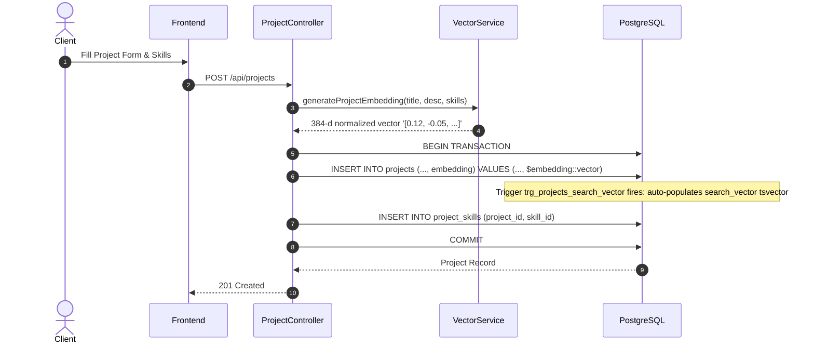
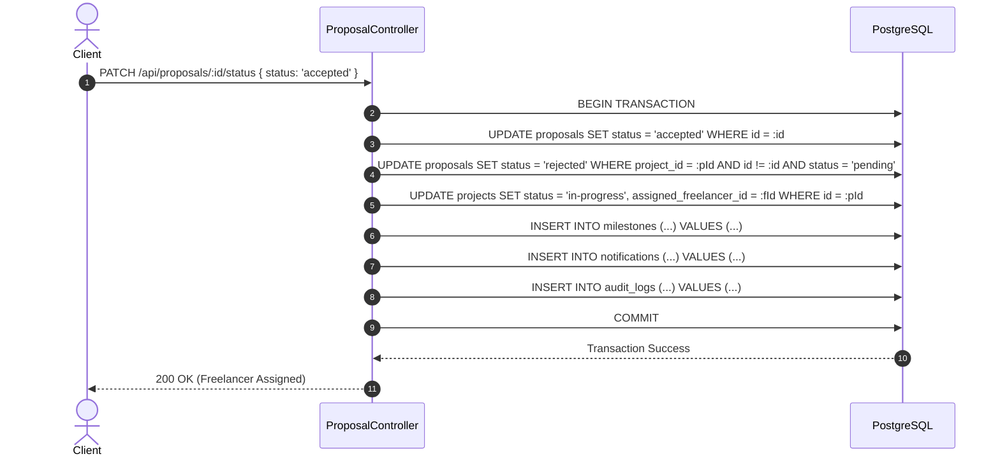
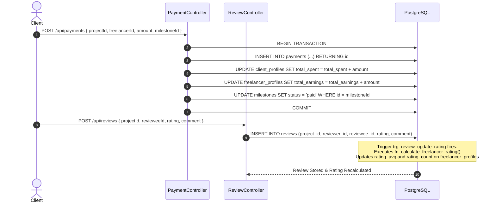

# FreelanceHub — Project Overview & Architecture Specification

## 1. Executive Summary

**FreelanceHub** is an enterprise-grade freelancer-client collaboration and project lifecycle management system designed for **DBMS Level 3** evaluation. The platform addresses the dual challenges of transactional data consistency and intelligent semantic discovery by pairing a **3NF-normalized PostgreSQL relational database** with **PostgreSQL's pgvector extension**.

---

## 2. Problem Statement & Motivation

Traditional online freelance marketplaces face key engineering bottlenecks:

1. **Transactional Fragility:**
   Accepting a proposal is not a simple row update. It requires an atomic transition:
   - Setting proposal status to `accepted`.
   - Rejecting all other competing bids for the project.
   - Updating project state to `in-progress` and binding the freelancer's foreign key.
   - Initializing payment milestone structures.
   - Creating notifications and audit logs.
   Without database-enforced ACID transactions, race conditions and partial failures corrupt platform state.

2. **Keyword Match Fragility (The "Semantic Gap"):**
   Traditional SQL `LIKE` or basic keyword searches fail when clients describe project needs using natural language that does not verbatim match freelancer profiles (e.g., "Full-Stack SaaS Platform with TypeScript" vs. "Frontend React & Backend Node Architect"). A vector database paradigm solves this by projecting semantic meaning into dense mathematical vector spaces.

3. **Reputation Drift:**
   User ratings in poorly architected systems become inconsistent due to delayed batch updates. FreelanceHub solves this with **database triggers** that recompute weighted rating averages on the database engine itself immediately upon review insertion, update, or deletion.

---

## 3. Dual Database Paradigm Specification

FreelanceHub implements two distinct database paradigms within a unified PostgreSQL runtime:

```
+-------------------------------------------------------------------------+
|                  DUAL DATABASE PARADIGM ARCHITECTURE                    |
+-----------------------------------+-------------------------------------+
|        PARADIGM 1: RELATIONAL     |         PARADIGM 2: VECTOR          |
|             (PostgreSQL)          |              (pgvector)             |
+-----------------------------------+-------------------------------------+
| • 15 Normalized Tables (3NF)      | • 384-Dimensional Dense Vectors     |
| • Primary & Foreign Keys          | • Cosine Distance Operator (<=>)    |
| • Multi-Table ACID Transactions   | • Semantic Skill Match Score (%)    |
| • 5 Compiled Analytical Views     | • Bidirectional Matching (Projects  |
| • Stored Procedures & Triggers    |   to Freelancers & Freelancers to   |
| • GIN Full-Text Indexing (tsvector)|   Projects)                         |
| • Strict CHECK & UNIQUE Rules     | • Real-time Similarity Ordering     |
+-----------------------------------+-------------------------------------+
```

---

## 4. System Roles & User Stories

### 4.1 Client Role
- **As a Client**, I can post project briefs specifying title, category, budget, budget type (fixed/hourly), deadline, experience level, and required skills.
- **As a Client**, I can inspect incoming proposals, comparing bids by price, timeline, freelancer rating, and experience years.
- **As a Client**, I can accept a candidate's proposal with an atomic transaction that updates the contract and assigns the freelancer.
- **As a Client**, I can define phased milestones and release escrow payments.
- **As a Client**, I can view AI-recommended freelancers ranked by pgvector cosine similarity against my project brief.
- **As a Client**, I can leave star ratings and feedback upon milestone completion.

### 4.2 Freelancer Role
- **As a Freelancer**, I can maintain a verified technical profile with hourly rates, skills, portfolio links, and biographical details.
- **As a Freelancer**, I can discover projects using full-text search (`tsvector`) or open the **AI Semantic Matches** tab to view opportunities tailored to my skill embedding.
- **As a Freelancer**, I can submit proposals with proposed budgets, delivery schedules, and cover letters.
- **As a Freelancer**, I can update task states (`todo` -> `in-progress` -> `review` -> `completed`) on assigned projects.
- **As a Freelancer**, I can track payment disbursements in a verified earnings ledger.

### 4.3 Administrator Role
- **As an Admin**, I can inspect platform metrics calculated live from `view_platform_analytics`.
- **As an Admin**, I can audit all user accounts and toggle active/suspended statuses with automated audit trails.
- **As an Admin**, I can monitor platform transactions and escrow flows.
- **As an Admin**, I can test and demonstrate complex SQL operations (multi-table joins, subqueries, view outputs, GIN search, vector cosine queries) via the **DBMS SQL Console**.

---

## 5. End-to-End System Workflows

### Workflow 1: Project Creation to Semantic Vectorization


### Workflow 2: Transactional Proposal Acceptance


### Workflow 3: Milestone Disbursement & Rating Recalculation


---

## 6. Software Quality & Engineering Standards

- **Zero Hardcoded Mockups:** All dashboard metric cards, charts, and tables query real PostgreSQL views and tables.
- **ACID Transaction Guarantees:** Critical financial and contract transitions are wrapped in atomic transaction blocks (`BEGIN`, `COMMIT`, `ROLLBACK`).
- **SQL Injection Prevention:** 100% of database queries use parameterized placeholders (`$1, $2, ...`) without raw string interpolation.
- **Type Safety:** The frontend is strictly typed using TypeScript with zero compiler errors (`npx tsc --noEmit` clean).
- **Responsive Linear/Upwork SaaS Aesthetic:** Clean layout with status indicators, responsive side navigation, accessible modals, and visual KPI cards.
